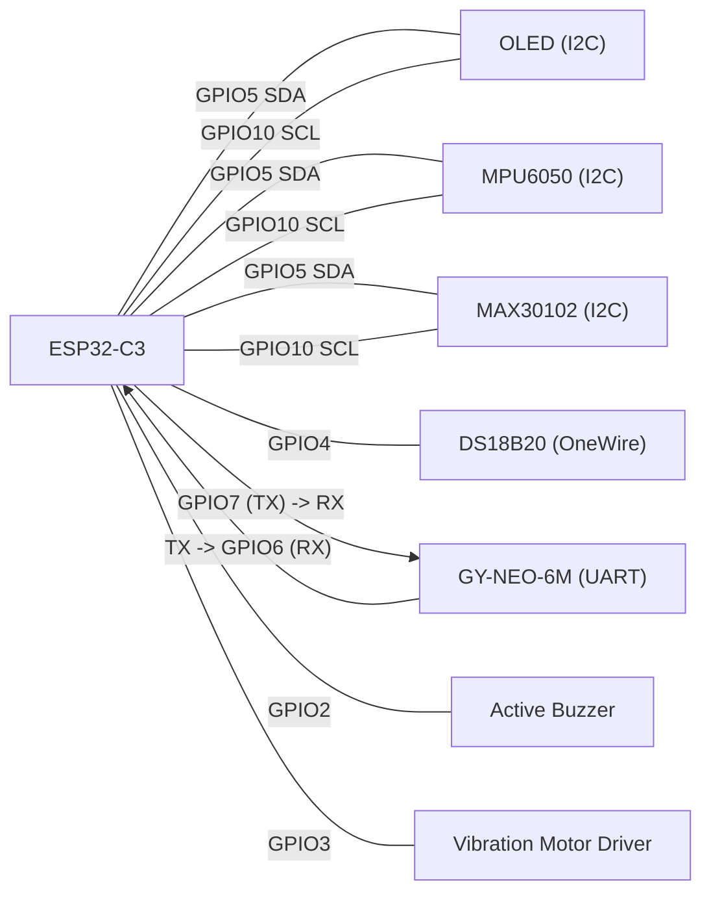

# ESP32-C3 Pin Diagram

This diagram is generated from:
- [wearable config](C:/Users/fanxi/.codex/worktrees/e0c0/heat/firmware/wearable_c3/src/config.h)

## C3 Pin Overview

## Pin Table

| GPIO | Function | Connected Module |
|---|---|---|
| GPIO5 | I2C SDA | OLED, MPU6050, MAX30102 |
| GPIO10 | I2C SCL | OLED, MPU6050, MAX30102 |
| GPIO4 | OneWire | DS18B20 |
| GPIO6 | UART RX | GPS TX |
| GPIO7 | UART TX | GPS RX |
| GPIO2 | Digital Output | Active Buzzer |
| GPIO3 | Digital Output | Vibration Motor Driver |

## Bus Parameters

- I2C frequency: `100000` Hz
- GPS UART baud rate: `9600`

## Wiring Notes

- Use a transistor or MOSFET driver for vibration motor current.
- Do not drive motor load directly from GPIO.
- Confirm voltage level compatibility on I2C and UART lines.
