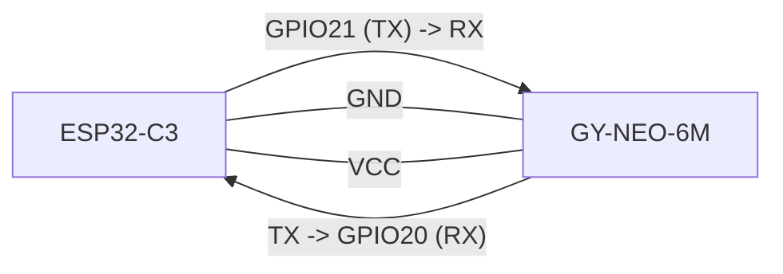
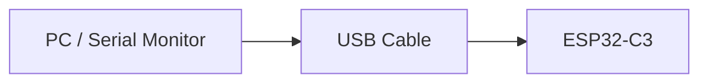

# ESP32-C3 Serial Diagram

This diagram shows serial lines related to the wearable C3 board.

## 1) C3 UART to GPS (GY-NEO-6M)

Default pins from:
- [wearable config](C:/Users/fanxi/.codex/worktrees/e0c0/heat/firmware/wearable_c3/src/config.h)

Pin mapping:
- `C3 GPIO20 (RX)` <- `GPS TX`
- `C3 GPIO21 (TX)` -> `GPS RX`
- `C3 GND` <-> `GPS GND`
- `C3 VCC` -> `GPS VCC` (match module voltage requirement)

## 2) C3 USB Debug Serial

Use this port for:
- firmware upload
- runtime logs (`[C3] ...`)
- troubleshooting Wi-Fi / sensors / HTTP upload / override apply
