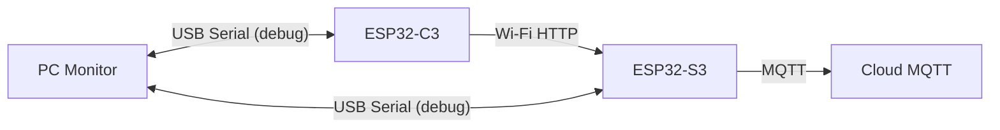

# Serial Diagrams Index

This page links to dedicated serial diagrams for each board.

## Files

- [C3 Serial Diagram](C:/Users/fanxi/.codex/worktrees/e0c0/heat/docs/serial_c3.md)
- [S3 Serial Diagram](C:/Users/fanxi/.codex/worktrees/e0c0/heat/docs/serial_s3.md)

## Important Architecture Note

- `ESP32-C3` and `ESP32-S3` do not communicate over UART.
- Their data path is `Wi-Fi LAN + HTTP JSON`.

