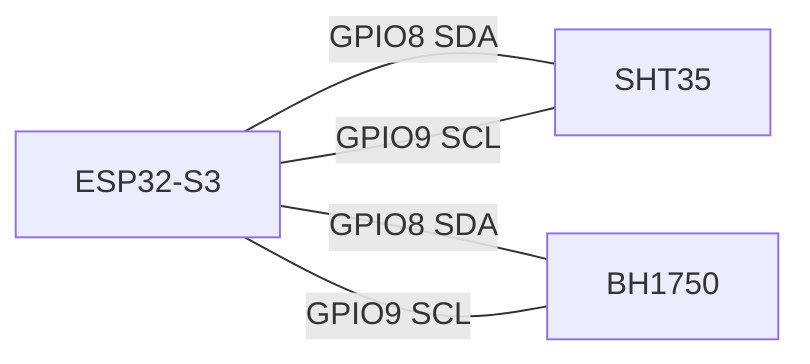

# ESP32-S3 串口图

本图描述网关 `ESP32-S3` 的串口关系与调试口用途。

## 1) S3 USB 调试串口

这个串口用于：
- 固件烧录
- 运行日志查看（`[S3] ...`）
- 联调排障（Wi-Fi / HTTP API / MQTT 桥接 / 命令缓存）

## 2) S3 传感器总线（I2C，不是 UART）

`SHT35` 和 `BH1750` 接在 S3 的 I2C 总线上，不使用 UART。

默认引脚配置见：
- [config.h](C:/Users/fanxi/.codex/worktrees/e0c0/heat/firmware/gateway_s3/src/config.h)

## 3) 与 C3 的通信提醒

当前架构中，`C3 <-> S3` 不存在 UART 数据链路。
