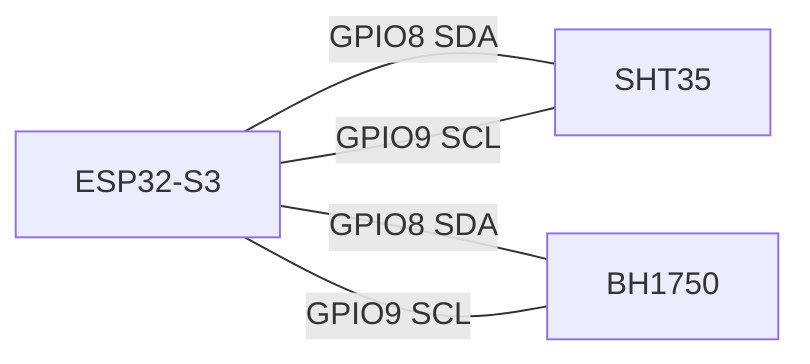

# ESP32-S3 Serial Diagram

This diagram shows serial lines related to the gateway S3 board.

## 1) S3 USB Debug Serial

Use this port for:
- firmware upload
- runtime logs (`[S3] ...`)
- troubleshooting Wi-Fi / HTTP API / MQTT bridge / command cache

## 2) S3 Sensor Bus (Not UART)

S3 sensors (`SHT35`, `BH1750`) are connected by I2C, not UART.

Default pins from:
- [gateway config](C:/Users/fanxi/.codex/worktrees/e0c0/heat/firmware/gateway_s3/src/config.h)

## 3) C3 to S3 Reminder

There is no C3-to-S3 UART data link in the current architecture.
